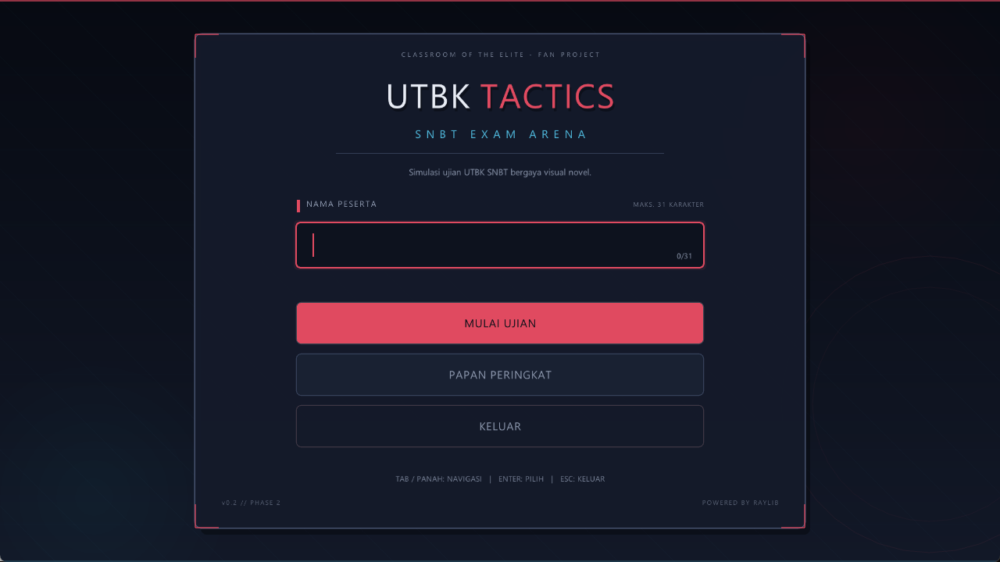
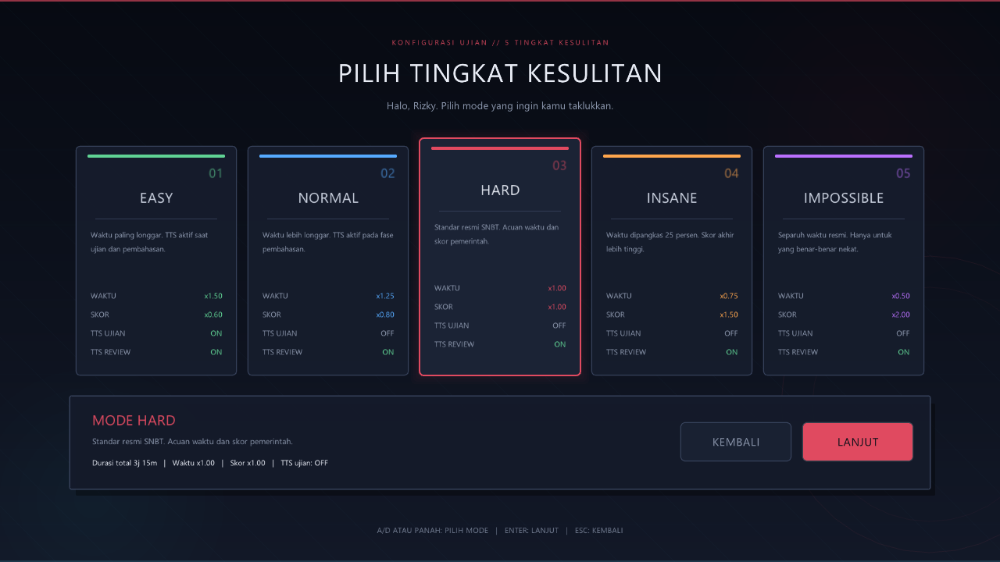
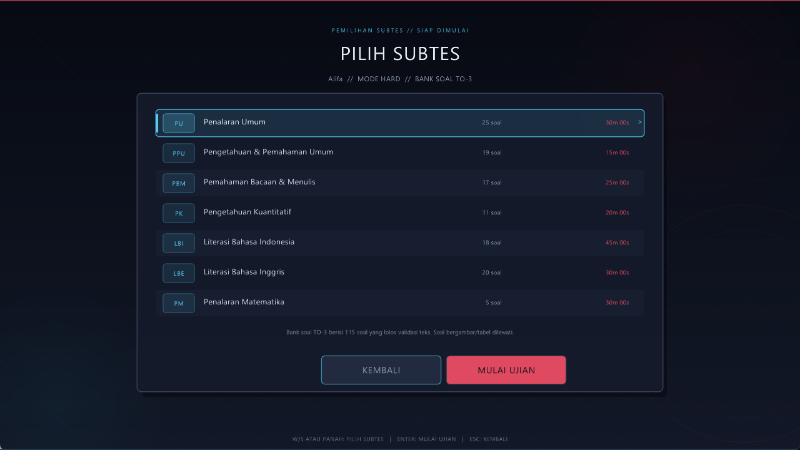
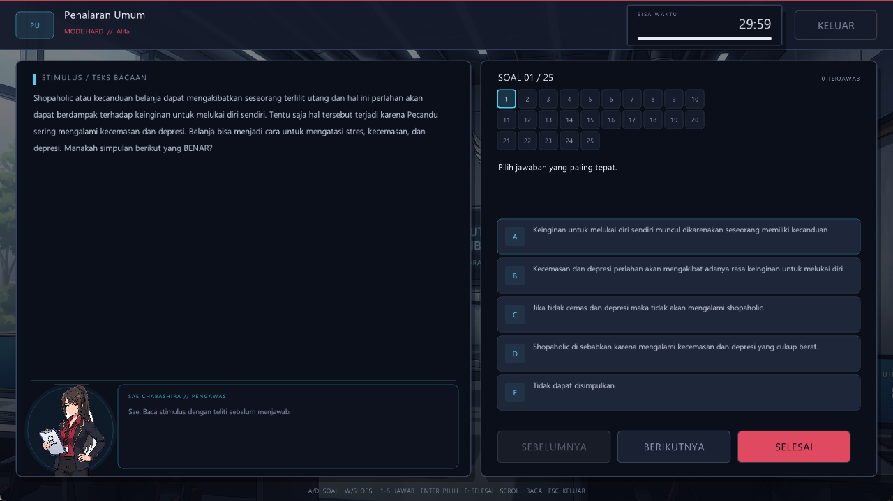
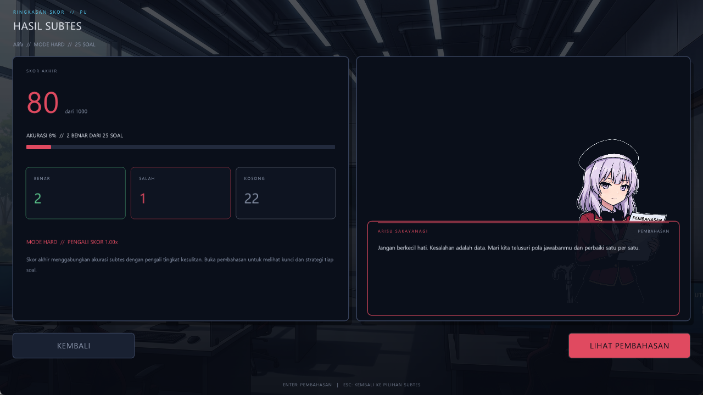
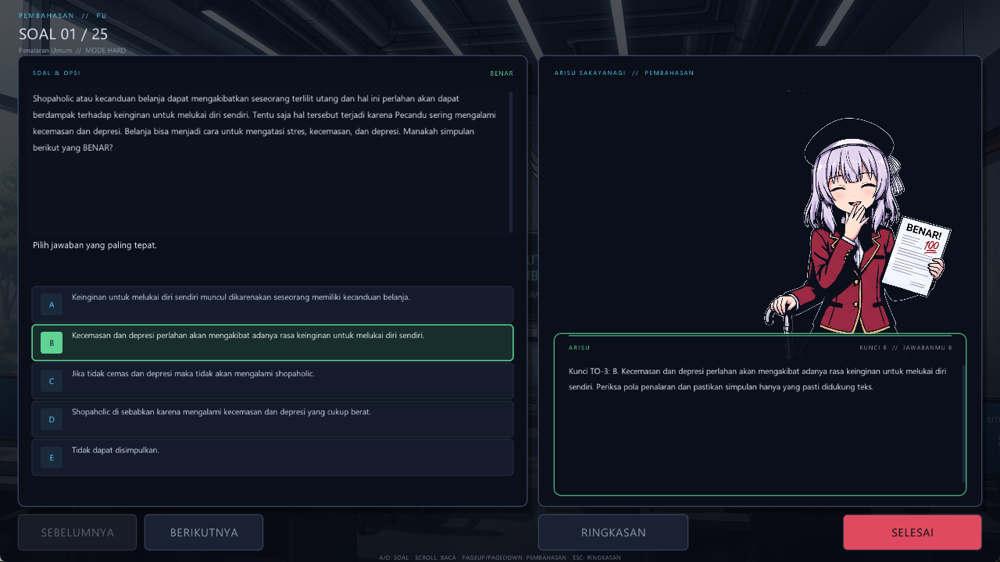

# UTBK Tactics: SNBT Exam Arena

Game edukasi berbasis **C99** dan **Raylib** yang mensimulasikan UTBK SNBT dengan nuansa visual novel. Pemain memasukkan nama, memilih tingkat kesulitan, lalu menjalani sesi ujian yang dipandu oleh karakter bergaya *Classroom of the Elite*.

> **Status:** Core Phase 4 selesai. Layar ujian memakai bank soal TO-3 hasil ekstraksi, ringkasan skor, dan pembahasan per nomor bersama Arisu. TTS dan leaderboard masih placeholder.



## Tangkapan Layar

| Pemilihan Difficulty | Pemilihan Subtes |
| :---: | :---: |
|  |  |

### Layar Ujian







## Fitur Saat Ini

- State machine dengan 7 state sesuai SDD: menu, difficulty, subtes, ujian, ringkasan skor, pembahasan, dan leaderboard.
- Input nama pemain interaktif dengan validasi, batas 31 karakter, caret, dan backspace.
- Lima tingkat kesulitan dengan konfigurasi time multiplier, score multiplier, dan status TTS.
- Pemilihan subtes interaktif dengan 7 subtes resmi UTBK SNBT dan durasi per subtes.
- Layar ujian bergaya visual novel dengan background kelas, portrait Sae, dan dialog pengawas.
- Panel stimulus dengan word-wrap, scrollbar, serta gulir via mouse wheel dan `PageUp`/`PageDown`.
- Panel soal dengan navigator, status terjawab, opsi A–E (mendukung soal 4 opsi), dan fokus keyboard/mouse.
- Bank soal TO-3 hasil ekstraksi: 115 soal yang lolos validasi teks; soal bergambar/tabel dilewati.
- Ringkasan skor per subtes: benar, salah, kosong, akurasi, dan skor akhir dengan pengali difficulty.
- Pembahasan per nomor bersama Arisu: kunci, jawaban pengguna, highlight opsi, dan strategi subtes.
- Overlay konfirmasi selesai ujian, keluar ujian, dan waktu habis.
- Font sistem otomatis (Segoe UI / DejaVu Sans) dengan fallback ke font bawaan Raylib.
- Placeholder untuk TTS dan leaderboard (Phase 5).

## Teknologi

- **Bahasa:** C99
- **Graphics & Multimedia:** Raylib 5.5+
- **Build:** GNU Make / GCC (MinGW-w64)
- **Target:** Windows (MSYS2 UCRT64) dan Linux

## Struktur Proyek

```text
.
├── src/
│   ├── main.c              # Entry point dan game loop
│   ├── game.c/.h           # State machine, session, difficulty, font, asset
│   ├── screens.c/.h        # Menu, difficulty, subtes, placeholder
│   ├── exam.c/.h           # Layar ujian, timer, scroll, overlay
│   ├── review.c/.h         # Ringkasan skor dan pembahasan Arisu
│   ├── question_bank.c/.h  # Bank soal TO-3 per subtes
│   └── ui.c/.h             # Komponen UI custom
├── assets/
│   ├── backgrounds/
│   │   └── exam_room.jpg
│   └── characters/
│       ├── sae_*.png
│       └── arisu_*.png
├── docs/
│   └── screenshots/        # Dokumentasi visual
├── Makefile
├── Plan.md
├── SDD.md
└── README.md
```

## Persyaratan

- GCC dengan dukungan C99
- Raylib **5.5 atau lebih baru**
- GNU Make (opsional, untuk build via Makefile)

## Cara Build

### Windows — MSYS2 UCRT64 (direkomendasikan)

Jalankan dari **MSYS2 UCRT64** shell:

```bash
pacman -Syu
pacman -S mingw-w64-ucrt-x86_64-gcc mingw-w64-ucrt-x86_64-raylib make
```

Lalu dari folder proyek:

```bash
make
./utbk_tactics.exe
```

### Windows — PowerShell (build manual)

Pastikan GCC dan Raylib sudah terpasang dan tersedia di `PATH`:

```powershell
gcc -std=c99 -Wall -Wextra -O2 -Isrc src/main.c src/game.c src/ui.c src/screens.c `
    src/exam.c src/review.c src/question_bank.c `
    -o utbk_tactics.exe -lraylib -lopengl32 -lgdi32 -lwinmm -luser32 -lm

.\utbk_tactics.exe
```

### Linux

Pastikan Raylib 5.5+ tersedia. Jika paket distro masih lebih lama, build Raylib dari source terlebih dahulu.

```bash
make
./utbk_tactics
```

## Kontrol

### Menu Utama

| Tombol | Aksi |
| --- | --- |
| Ketik | Mengisi nama pemain |
| `Tab` / `↑` / `↓` / `W` / `S` | Berpindah fokus |
| `Enter` | Memilih / melanjutkan |
| `Backspace` | Menghapus karakter |
| `Esc` | Keluar |

### Pemilihan Difficulty

| Tombol | Aksi |
| --- | --- |
| `A` / `D` / `←` / `→` | Memilih difficulty |
| `1`–`5` | Memilih difficulty secara langsung |
| `Enter` / `Space` | Lanjut ke pemilihan subtes |
| `Esc` | Kembali ke menu |

### Pemilihan Subtes

| Tombol | Aksi |
| --- | --- |
| `W` / `S` / `↑` / `↓` | Memilih subtes |
| `Enter` | Memulai ujian |
| `Esc` | Kembali ke pemilihan difficulty |

### Layar Ujian

| Tombol | Aksi |
| --- | --- |
| `A` / `D` / `←` / `→` | Soal sebelumnya / berikutnya |
| `W` / `S` / `↑` / `↓` | Memindahkan fokus opsi |
| `1`–`5` | Memilih jawaban A–E |
| `Enter` | Mengunci jawaban pada opsi yang fokus |
| `F` | Membuka konfirmasi selesai ujian |
| `PageUp` / `PageDown` / scroll | Menggulir teks stimulus |
| `Esc` | Membuka konfirmasi keluar ujian |
| Mouse | Klik opsi, navigator soal, dan tombol |

### Ringkasan Skor dan Pembahasan

| Tombol | Aksi |
| --- | --- |
| `Enter` | Membuka pembahasan dari ringkasan skor |
| `A` / `D` / `←` / `→` | Soal pembahasan sebelumnya / berikutnya |
| Scroll / `PageUp` / `PageDown` | Menggulir teks atau penjelasan |
| `Esc` | Kembali ke ringkasan skor / pilihan subtes |
| Mouse | Klik tombol navigasi dan opsi |

## Roadmap

- [x] **Phase 1** — Boilerplate, state machine, input nama, pemilihan difficulty
- [x] **Phase 2** — Layout ujian, scrolling passage, sprite Sae Chabashira
- [x] **Phase 3 (subset)** — Ekstraksi TO-3, bank 115 soal, parsing passage dan kunci
- [x] **Phase 4 (core)** — Ringkasan skor, pembahasan per nomor, sprite Arisu
- [ ] **Phase 3 (lanjutan)** — Bank soal lengkap dari tryout lain, seleksi acak
- [ ] **Phase 4 (lanjutan)** — TTS dan pembahasan yang lebih mendalam
- [ ] **Phase 5** — Leaderboard Top 10, file I/O, memory management

## Catatan Pengembangan

- Bank saat ini berisi 115 soal TO-3 yang lolos validasi teks. Soal yang bergantung pada gambar, grafik, atau tabel dilewati.
- Kunci LBI nomor 21–30 tidak tersedia pada tabel kunci yang diekstrak, sehingga bank LBI berhenti di nomor 18.
- Skor akhir memakai akurasi subtes dan pengali difficulty; ini bukan simulasi IRT penuh.
- Pembahasan menampilkan kunci dan strategi subtes, bukan analisis langkah demi langkah yang dikarang.
- Aset karakter berada di `assets/characters/` dan background di `assets/backgrounds/`.

## Kredit & Disclaimer

Proyek penggemar yang tidak berafiliasi dengan penyelenggara resmi UTBK/SNBT maupun pemegang hak *Classroom of the Elite*. Karakter dan aset pihak ketiga tetap menjadi milik pemegang haknya masing-masing.

Dibuat dengan [Raylib](https://www.raylib.com/).

## Lisensi

Kode sumber dilisensikan di bawah [MIT License](LICENSE).
